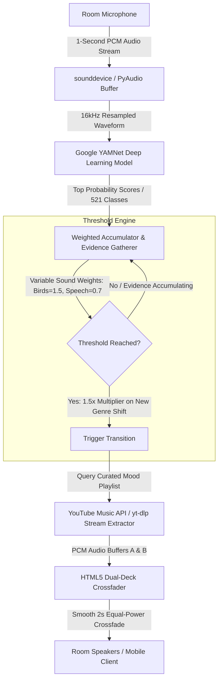

# 🎧 Automated-Ambience — AI-Powered Acoustic Mood DJ

[](https://www.python.org/)
[](https://tfhub.dev/google/yamnet/1)
[](https://flask.palletsprojects.com/)
[](https://github.com/yt-dlp/yt-dlp)
[](#interface)

> **Automated-Ambience** is an autonomous ambient DJ that listens to acoustic signals in your room and automatically steers background audio to complement your real-time environment. Whether you are typing quietly, sharing dinner with friends, or focusing on work, the system dynamically curates and transitions between mood-aligned soundscapes without manual intervention.

---

## 🖥️ Live Player Interface


*The adaptive glassmorphic interface dynamically shifts its theme color, ambient waveform, and status indicators based on real-time classification confidence and genre identity.*

---

## ⚡ How It Works



### 1. Acoustic Classification (Google YAMNet)
The system captures 1-second chunks of audio and classifies ambient noise against **521 acoustic event classes** (e.g., keyboard typing, laughter, clinking glasses, birdsong, silence).

### 2. Weighted Hysteresis & Anti-Flicker Logic
To prevent rapid switching ("genre thrashing"):
* **Evidence Gathering**: Repeated environmental sounds accrue confidence points over time.
* **Variable Weights**: Infrequent, distinctive acoustic triggers (e.g., laughter, birds) carry higher weight ($1.5\times$) than continuous background hums or general speech ($0.7\times$).
* **Cross-Genre Breakthrough**: When a proposed mood differs from what is currently playing, a $1.5\times$ boost helps break through the current mood once a sustained environmental shift is detected.

### 3. Dual-Deck Crossfading
The frontend runs two decoupled audio decks (`audioA` and `audioB`). When a mood shift occurs, the new stream pre-buffers before executing a smooth 2-second equal-power crossfade, preventing abrupt cuts or audio popping.

---

## 🚀 Quick Start

### 1. Install Dependencies
```bash
pip install flask numpy sounddevice tensorflow tensorflow-hub ytmusicapi yt-dlp
```

### 2. Run the Server
```bash
python main.py
```

### 3. Open the Interface
Once YAMNet loads into memory:
* **Host URL**: `http://127.0.0.1:5000`
* **Network Remote**: `http://<your-local-ip>:5000` *(control or output audio from your phone)*

---

## 📁 Repository Structure

```
├── main.py               # Flask REST server & audio acquisition loop
├── mapping.json          # YAMNet class ID to genre taxonomy mappings
├── genres.json           # Curated YouTube Music playlist seeds
└── templates/
    └── index.html        # Responsive glassmorphic UI, dual-deck crossfade logic
```
