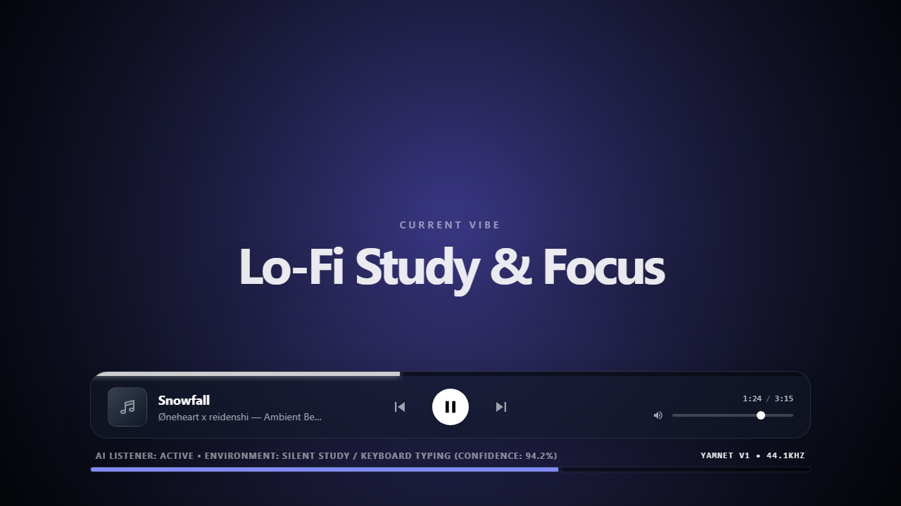

# Automated-Ambience — AI-Powered Acoustic Mood DJ

<div align="center">
  <h3>Autonomous Acoustic Environment Tracking & Dynamic Real-Time Soundscapes</h3>

  [](#3-quick-start)
  [](#2-how-it-works)
  [](#technical-stack--architecture)
  [](#technical-stack--architecture)
</div>

---

> **Automated-Ambience** is an autonomous ambient DJ that listens to acoustic signals in your room and automatically steers background audio to complement your real-time environment. Whether you are typing quietly, sharing dinner with friends, or focusing on work, the system dynamically curates and transitions between mood-aligned soundscapes without manual intervention.

---

## 1. Live Player Interface

<div align="center">
  <br />
  <b>Adaptive Glassmorphic Player UI</b><br />
  <i>Real-time classification confidence feedback, ambient waveform visualization, and dynamic genre-tinted themes</i>
</div>

---

## 2. How It Works

1. **Acoustic Classification (Google YAMNet)**: Captures 1-second chunks of audio via `sounddevice` and classifies ambient noise across 521 acoustic event classes (e.g., keyboard typing, laughter, speech, silence).
2. **Weighted Threshold System**: Repeated environmental sounds accumulate points over time. Distinctive sounds (e.g., laughter, bird chirps) carry higher weight (1.5x) than continuous background noise (0.7x).
3. **Cross-Genre Breakthrough**: When a new mood is proposed, a 1.5x multiplier allows sustained environmental shifts to break through the currently playing mood cleanly.
4. **Dual-Deck Crossfade**: Two decoupled audio decks (`audioA` and `audioB`) pre-buffer incoming streams before executing a smooth 2-second equal-power crossfade to prevent audio pops.

---

## 3. Quick Start

### 1. Install Dependencies
Ensure Python 3.8+ is installed. Install required packages:
```bash
pip install flask numpy sounddevice tensorflow tensorflow-hub ytmusicapi yt-dlp
```

### 2. Run the Server
From your terminal, start the main application:
```bash
python main.py
```

### 3. Open the Interface
Once the YAMNet model finishes loading, access the interface at:
* **Host URL**: `http://127.0.0.1:5000`
* **Network Remote**: `http://<your-local-ip>:5000` *(phone control and output)*

---

## Technical Stack & Architecture

* **Acoustic Machine Learning**: Pre-trained **Google YAMNet** (TensorFlow Hub) evaluating 521 audio event categories from real-time microphone buffers.
* **Backend Audio Pipeline**: **Python / Flask** with `sounddevice` for multi-threaded continuous audio capture and weighted threshold accumulation.
* **Music Streaming Engine**: **yt-dlp** and **ytmusicapi** for querying mood-matched playlists and extracting direct audio streams.
* **Frontend Interface**: Responsive glassmorphic UI with dynamic background color shifting to match genre color identity, dual-deck Web Audio crossfading, and playback controls.

---

## Repository Structure

* `main.py` — Flask REST server and audio acquisition loop
* `mapping.json` — YAMNet class ID to genre taxonomy mappings
* `genres.json` — Curated YouTube Music playlist seeds
* `templates/index.html` — Responsive glassmorphic UI, audio buffers, and cross-fade logic
